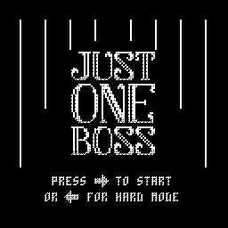
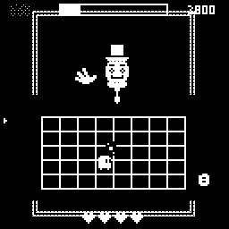
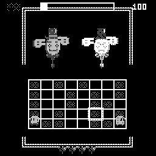
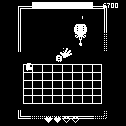

# Just One Boss — Macintosh Classic Port

A port of [**Just One Boss** by Ayla Nonsense](https://github.com/aylanonsense/just-one-boss)
— the beloved PICO-8 one-boss bullet-dodger — to the **original 1-bit black & white
Macintosh Classic** (System 6/7, 8 MHz 68000). Written in C, built with
[Retro68](https://github.com/autc04/Retro68), runs in Mini vMac or on real hardware.

**Ported with the creator's permission.** Play the original at
[aylanonsense.itch.io](https://aylanonsense.itch.io/) — it's wonderful.

 

## What's in the port

- The complete game: tutorial → four boss phases (cards, lasers, flower fields,
  coins, falling hats) → mirror reflections of the boss *and* the player →
  victory/game-over → retry loop
- **Hard mode** (faster patterns + transient boss reflections), unlocked by a win,
  with its own high-score slots — scores persist to a file beside the app
- All sound effects and two music loops plus victory/game-over stingers,
  pre-rendered from the cartridge's synth data and played through the Sound Manager
- Full phase-change cinematics (the finger-wag intro, fist pounds, the bouquet,
  wand-conjuring spells)
- A 16-color → 1-bit art translation: solid-and-line rendering tuned for the
  Classic's screen, with the authentic PICO-8 font (CC-0, Lexaloffle)
- Real Mac niceties: menu bar, File ▸ Quit, About box

 

## Play it

Grab **`JustOneBoss.dsk`** from this repo (or build it, below). Boot a System 6/7
disk in [Mini vMac](https://www.gryphel.com/c/minivmac/) (1-bit display), drag the
`.dsk` on, and double-click the app. `JustOneBoss.bin` is the same app as MacBinary
for transfer to real 68k hardware.

Controls: **arrows** move · **→** start · **←** hard mode · **File ▸ Quit** exits.
Collect the glowing tiles to fill the boss bar while dodging everything.

## Build from source

Install [Retro68](https://github.com/autc04/Retro68), then:

```bash
./build.sh          # -> JustOneBoss.dsk
```

See [BUILD.md](BUILD.md) for toolchain setup, emulator notes, and the headless
test harness (`tools/host_test.c` runs the real game logic on a modern machine
and renders frames to images — how most of this port was verified).

[PORTING-PLAN.md](PORTING-PLAN.md) documents the architecture: a small PICO-8
API emulation layer over an index framebuffer, an entity system translated from
the original's Lua, a concurrent-timeline choreography engine for the boss, and
the dirty-row 1-bit dither pipeline that keeps an 8 MHz 68000 breathing.

The `tools/` pipeline regenerates everything from the original cartridge
(sprites/map via `extract_cart.py`, audio via `synth_sfx.py` — an offline PICO-8
synthesizer — and the font via `make_font.py`). The cartridge itself is not
included here; it lives in [the creator's repository](https://github.com/aylanonsense/just-one-boss).

## Credits

- **Just One Boss** — game, art, music, and design by
  [Ayla Nonsense](https://github.com/aylanonsense). Ported with permission.
- **PICO-8 font** — CC-0 by Lexaloffle, extracted via the
  [tac08](https://github.com/0xcafed00d/tac08) /
  [fake-08](https://github.com/jtothebell/fake-08) font sheet.
- Port developed with [Claude Code](https://claude.com/claude-code).

The port's C code is © Mitchell Vizensky. The game's design, art, and music
remain © Ayla Nonsense.
